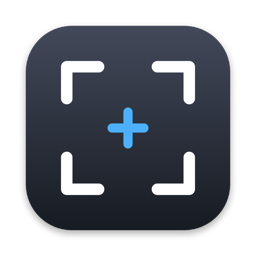

<p align="center">
  
</p>

<h1 align="center">MinimalCapture</h1>

<p align="center">
  A tiny macOS menu bar screenshot tool. Press a shortcut, the capture is on your clipboard and saved to disk.<br>
  No editor, no cloud, no account, about 12 MB of memory while idle.
</p>

---

## What it does

| Shortcut | Action |
|---|---|
| <kbd>⇧</kbd><kbd>⌘</kbd><kbd>3</kbd> | Capture the whole screen (the display your pointer is on) |
| <kbd>⇧</kbd><kbd>⌘</kbd><kbd>4</kbd> | Drag to capture an area. <kbd>Esc</kbd>, a right-click or a plain click cancels |
| <kbd>⇧</kbd><kbd>⌘</kbd><kbd>V</kbd> | Show the last 20 captures. Click one to put it back on the clipboard. This shortcut can be changed or turned off |

Every capture is copied to the clipboard straight away and saved as a PNG named like
`Capture-2026-11-19-18.39.10.png`.

From the menu bar icon you can also:

- **Change History Shortcut…** — pick a different key combination for the history panel, or
  turn it off, if ⇧⌘V clashes with a clipboard manager or another app.
- **Change Save Folder…** — captures go to the Desktop unless you pick somewhere else.
- **Keep Only Latest 20** — on by default. Older `Capture-*.png` files in the save folder are
  deleted after each capture; nothing else in the folder is ever touched. Turn it off to keep
  everything.
- **Start at Login**.

## Install

Requires macOS 14 or later. The app is signed with a Developer ID and notarised by Apple.

> **Do this first: turn off the built-in screenshot shortcuts.**
> macOS keeps ⇧⌘3 and ⇧⌘4 for its own screenshot tool, and while it does, MinimalCapture
> never sees them. Open **System Settings → Keyboard → Keyboard Shortcuts… → Screenshots** and
> untick:
>
> - **Save picture of screen as a file** (⇧⌘3)
> - **Save picture of selected area as a file** (⇧⌘4)
>
> If another screenshot app uses those shortcuts, quit it or change its shortcuts too.

### Option 1: Homebrew

```bash
brew tap glennsheff/tap && brew trust glennsheff/tap && brew install --cask minimalcapture
```

The `brew trust` part is required by Homebrew 7 and later for any third-party tap; on an older
Homebrew, leave it out.

Update later with `brew upgrade --cask minimalcapture`.

### Option 2: Direct download

1. Download `MinimalCapture.zip` from the [latest release](../../releases/latest).
2. Unzip it and move `MinimalCapture.app` to your Applications folder.

To update, download the new release and replace the app.

### First launch

1. Open MinimalCapture. It lives in the menu bar; there is no Dock icon.
2. Grant **Screen Recording** when the app asks. If macOS offers *Quit & Reopen*, accept it.
3. Press ⇧⌘3. If the macOS screenshot thumbnail appears instead of MinimalCapture's shutter
   sound and a file in your save folder, the built-in shortcuts are still on; see above.

> **Heads-up:** while MinimalCapture is running, ⇧⌘V belongs to it everywhere. Some apps use
> that shortcut for "Paste and Match Style", and clipboard managers often want it too. If it
> gets in the way, choose **Change History Shortcut…** from the menu bar icon.

Developed and tested on macOS 27 on Apple silicon. The release build is universal, but the
Intel half is untested.

## Build from source

You need Xcode 26 or later (Swift 6.2).

```bash
git clone https://github.com/glennsheff/MinimalCapture.git
cd MinimalCapture
./build-app.sh
open build/MinimalCapture.app
```

`build-app.sh` signs the app with the first code-signing identity in your keychain, or ad-hoc
if you have none. With an ad-hoc signature macOS treats every rebuild as a new app and asks for
Screen Recording again, so a certificate (a free *Apple Development* one from Xcode is enough)
saves a lot of clicking.

`release.sh` produces the notarised, universal zip attached to releases. It needs a
*Developer ID Application* certificate and stored notary credentials; see the notes at the top
of the script.

The icon is drawn in code. To change it, edit `Support/make-icon.swift` and run
`swift Support/make-icon.swift`.

## How it works

It is a Swift package with no dependencies and no Xcode project.

| File | Role |
|---|---|
| `AppDelegate.swift` | Menu bar item, settings, and the capture pipeline |
| `HotKeyCenter.swift` | Global shortcuts through Carbon's `RegisterEventHotKey` |
| `SelectionOverlay.swift` | The dimmed drag-to-select overlay |
| `CaptureEngine.swift` | One-shot capture with ScreenCaptureKit |
| `CaptureStore.swift` | PNG encoding, file naming, the rolling queue, thumbnails |
| `Clipboard.swift` | Pasteboard writes |
| `HistoryPanel.swift` | The floating history panel |
| `HistoryShortcut.swift` | The configurable history shortcut and its recorder dialog |
| `Permissions.swift` | Screen Recording onboarding |

A few choices that keep it small and out of the way:

- **Carbon hotkeys, not an event tap.** No Accessibility permission is needed, and the
  shortcuts keep working while a password field has Secure Input on.
- **Windows are created on demand and destroyed.** The overlay and the history panel exist
  only while they are on screen.
- **The clipboard gets PNG bytes, not an `NSImage`.** An `NSImage` on the pasteboard stays
  alive in the app, pinning the uncompressed bitmap (about 24 MB for a Retina screen). PNG
  bytes are handed to the system and nothing is retained; macOS still offers TIFF to apps that
  ask for it. The same bytes are written to disk, so each capture is compressed once.
- **History thumbnails come straight from ImageIO**, one file at a time, so the full-size
  images are never all in memory together.
- **The app never becomes the frontmost app.** The window you are capturing keeps its active
  appearance, and you can paste immediately after picking from the history.

### Things worth knowing

- The app is not sandboxed; global hotkeys require that.
- Showing a crosshair while another app is frontmost uses a non-public window-server setting.
  If a future macOS removes it, the pointer simply stays an arrow during selection.
- There is no window-capture mode, annotation, or text recognition.

## Licence

[MIT](LICENSE)
